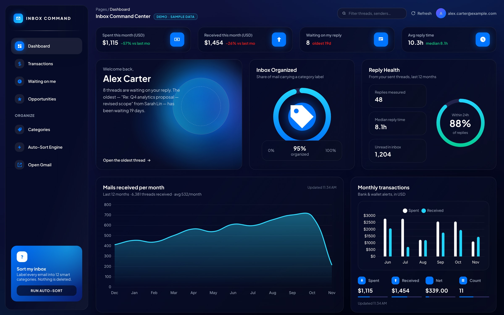
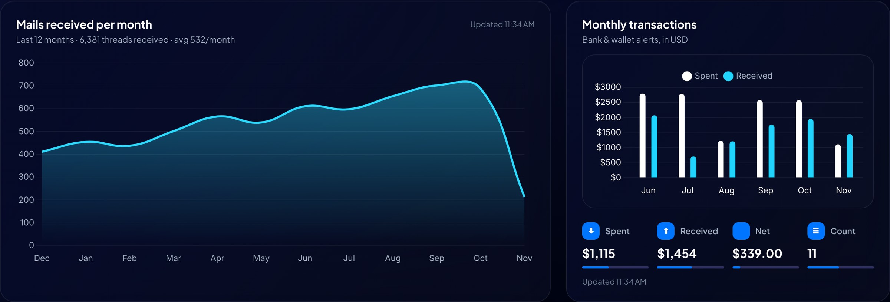
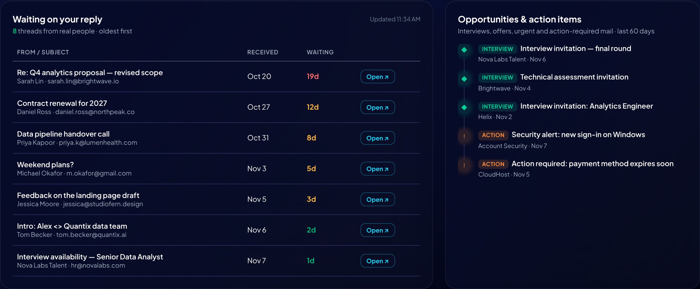
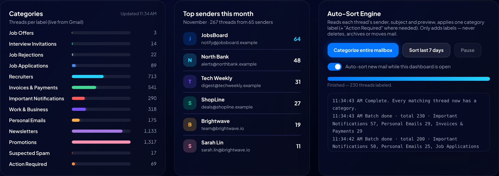

# Inbox Command Center

Gmail inbox command-center dashboard with auto-labelling: mail volume and transaction charts, "waiting on reply" and opportunity tracking, auto-sort categories, and a mobile-responsive layout.

This folder holds the portfolio material (screenshots, demo video and description — see [`upwork-portfolio-text.md`](upwork-portfolio-text.md)). The source code was not among the files on this computer.

| | |
|---|---|
|  |  |
|  |  |
