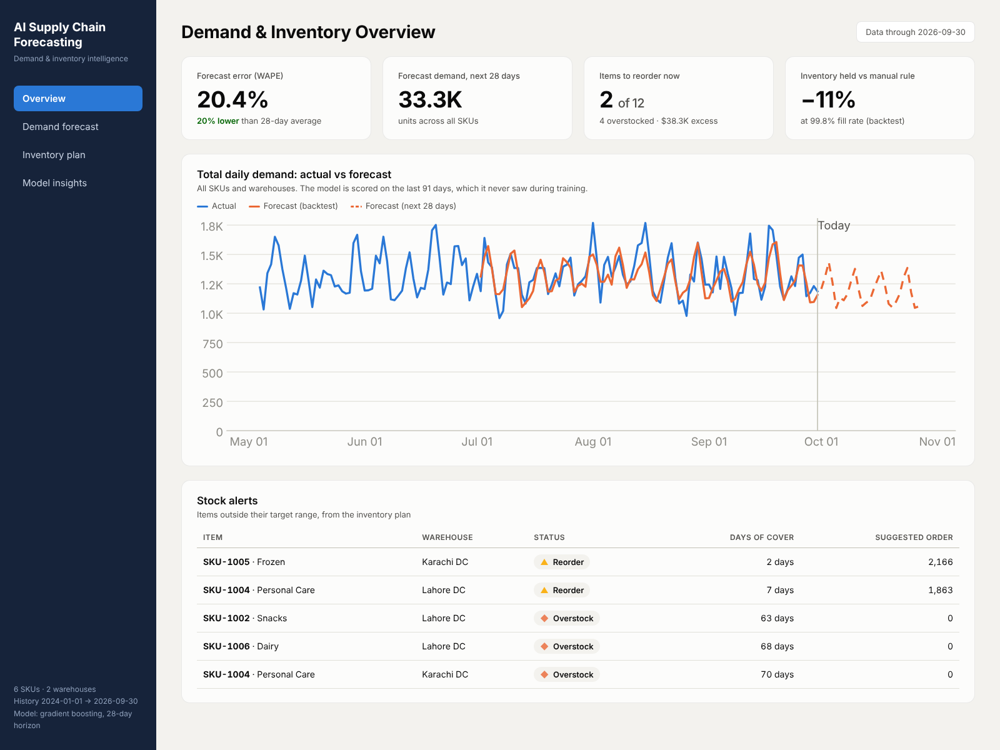
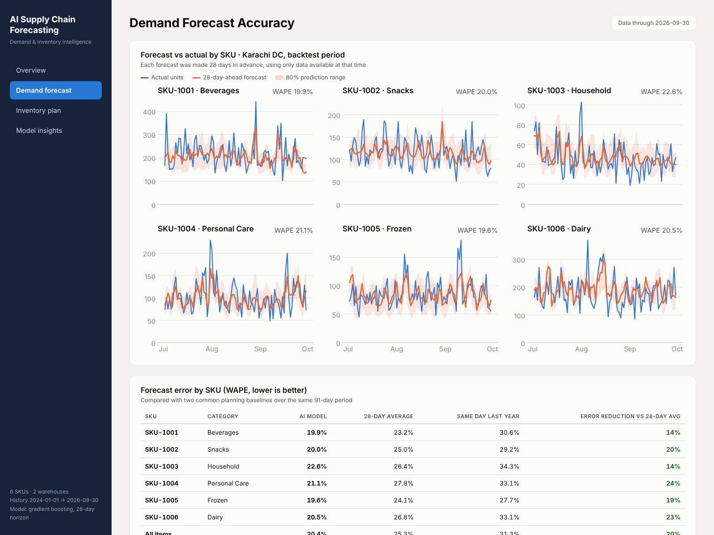
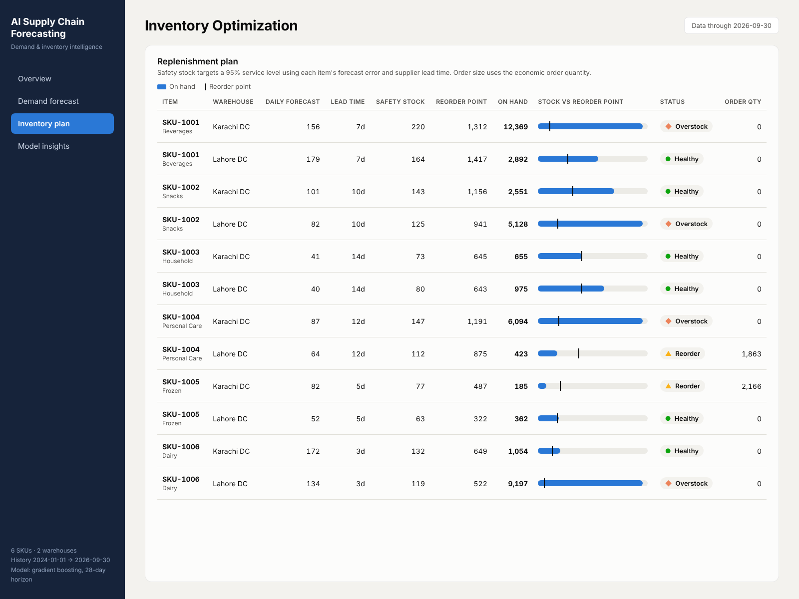
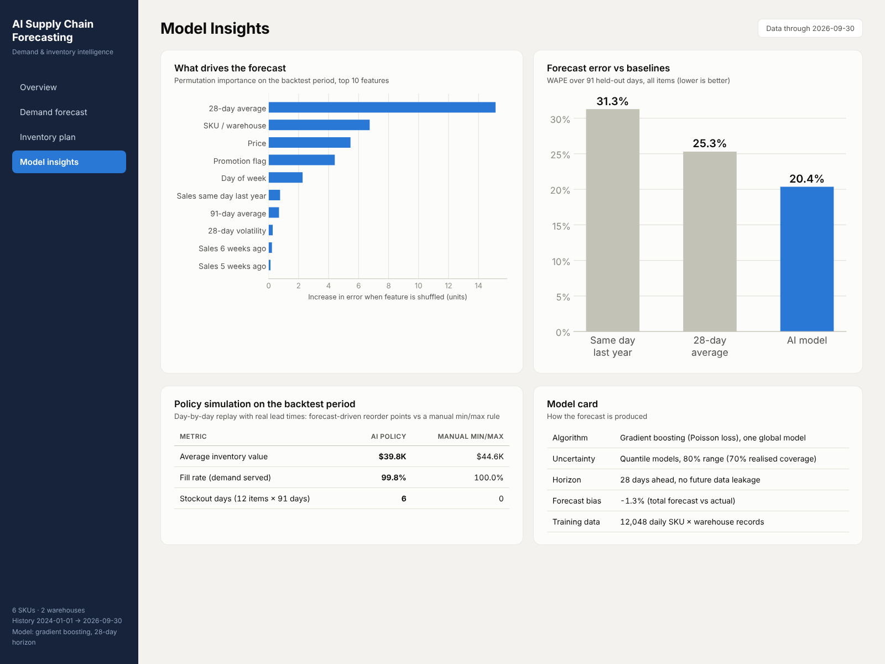

# AI-Powered Supply Chain Demand Forecasting & Inventory Optimization

An end-to-end system that forecasts product demand per SKU and warehouse, then turns those forecasts into replenishment decisions: safety stock, reorder points, order quantities and stock alerts.

> This folder is a lightweight, self-contained version that runs in about 10 seconds on sample data. The full platform with real datasets, API, Control Tower, procurement automation and AI Copilot (SCIP) is in the root of this repository.



## What it does

1. **Demand forecasting.** One global gradient-boosting model, trained across every SKU/warehouse series, predicts daily demand 28 days ahead. Features include lagged sales, rolling averages and volatility, calendar effects, price and promotions. Quantile models add an 80% prediction range.
2. **Honest backtesting.** The last 91 days are held out, and every feature uses only data available 28 days before the target date, so there is no leakage. Accuracy is compared against two baselines a planner would otherwise use.
3. **Inventory optimization.** For each item: safety stock for a 95% service level (from the model's own error and the supplier lead time), reorder point, economic order quantity, days of cover and a status (Healthy / Reorder / Critical / Overstock).
4. **Policy simulation.** A day-by-day replay of the backtest period with real lead times, comparing forecast-driven reordering against a manual min/max rule.

## Results (sample data, 91-day holdout)

| Method | Forecast error (WAPE) |
|---|---|
| Same day last year | 31.3% |
| 28-day moving average | 25.3% |
| **AI model** | **20.4%** |

- 20% lower forecast error than a 28-day moving average, with every SKU improving (14–24%).
- In the policy simulation, the forecast-driven policy held **11% less inventory** ($39.8K vs $44.6K average) at a **99.8% fill rate**. The manual rule reached 100% by carrying more stock.
- Forecast bias is −1.3%. The 80% prediction range covered 70% of actuals, so the intervals are somewhat narrow and could be calibrated further.

## Screenshots

| | |
|---|---|
|  |  |
|  | |

## Project structure

```
src/data.py         sample data generator (swap load_sales() for your own data)
src/forecast.py     features, model training, backtest, future forecast
src/inventory.py    safety stock, reorder point, EOQ, status, policy simulation
run_pipeline.py     runs everything and writes outputs/
dashboard/render.py renders the dashboard screens to screenshots/
outputs/            forecasts, backtest, inventory plan, summary.json
```

## Run it

```bash
pip install -r requirements.txt
python run_pipeline.py          # ~10 seconds
playwright install chromium     # once, for the dashboard screenshots
python dashboard/render.py      # screenshots + dashboard/index.html
```

On Windows, double-click `start_dashboard.bat` to open the dashboard at http://localhost:8000/dashboard/.

## About the data

The project ships with synthetic sales history (6 SKUs × 2 warehouses, Jan 2024 – Sep 2026) that includes trend, weekly and yearly seasonality, price changes, promotions and noise. It lets the whole pipeline run without private data. To use real data, replace `load_sales()` in `src/data.py` with a loader that returns the same columns (`date, sku, category, warehouse, units, price, promo, unit_cost, lead_time_days`), and replace `current_stock()` in `run_pipeline.py` with your stock levels.

## Tech stack

Python · pandas · NumPy · scikit-learn (HistGradientBoosting, quantile regression, permutation importance) · SciPy · matplotlib · Playwright
